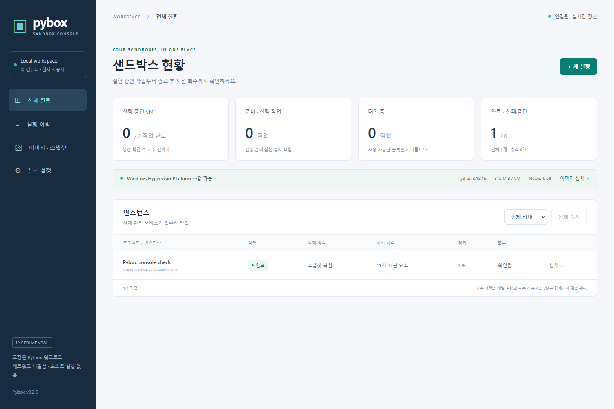

# Pybox

A native Rust controller for a lightweight, Hyperlight-backed Python sandbox on
Windows x64 and Linux x64. This is the independent home of the sandbox previously
developed inside QC. It has no runtime dependency on the QC application.

**Status: experimental, private project.** The current CLI runs a fixed, real
LangGraph/deepagents verification workload. It is not yet an arbitrary-script CLI
or a production service for untrusted tenants.

## Download and run

Download the matching archive and checksum from
[Releases](https://github.com/MichaelAlbertIhm/pybox/releases). Repository access is required.
Extract into a new, owner-controlled directory.

### Management console

Version 0.2 includes a local management service and embedded web console:

```powershell
.\pybox.exe manage --open
```

Windows users can also double-click `run-console.cmd`. Linux users can run
`./run-console.sh`. See running VMs, queued work, immutable per-job settings,
logs, cleanup receipts and history; stop individual/all jobs and set defaults.
`pybox submit`, `pybox jobs` and `pybox stop ID` use the same management API.
See [manager operation and API](docs/MANAGER.md). Counts cover the current user's
manager-owned work, not legacy controllers or other OS users.



Manager-specific verification and limitations are recorded in
[the v0.2 validation report](docs/MANAGER-VALIDATION.md).

### Standalone execution

The following commands run when no manager is active:

```powershell
# Windows: Windows Hypervisor Platform must already be enabled.
.\pybox.exe status
.\pybox.exe
.\pybox.exe --cold
```

```sh
# Linux x86-64: the current user needs read/write access to /dev/kvm.
./pybox status
./pybox
./pybox --cold
```

The default run prepares an empty local snapshot once, then restores a fresh VM
for each invocation. JSON reports framework results, timings, limits and cleanup.
No host Python, uv, Docker, Rust installation or provider API key is needed for
these runtime archives. Virtualization access is mandatory; there is no host fallback.

See [runtime commands](docs/RUN.md), [architecture and boundaries](docs/ARCHITECTURE.md),
[building and packaging](docs/BUILDING.md), and [validation](docs/VALIDATION.md).

## Develop

```sh
cargo build --release --locked --bin pybox
cargo test --locked --all-features
python -m unittest discover -s tests -v
```

The Rust package is `pybox-sandbox`; its existing library name
`python_sandbox_controller` is preserved. Cargo registry publishing is disabled.
The source build creates the controller only. Runtime inputs are separate release
assets; see BUILDING.md for obtaining or rebuilding them.

The library exposes guarded native execution and image/snapshot lifecycle APIs.
Its low-level process guard is **not** itself a VM boundary: only use a trusted VMM
executable with it. The packaged CLI supplies the pinned VMM and verified image.

## Scope

- Pinned Hyperlight Unikraft `hluk` v0.19.1; Docker-derived Python 3.12.15 image.
- LangGraph 1.2.19 and deepagents 0.7.32; deterministic model fixture, no live LLM.
- Image and snapshot hashes, two OS-held execution leases per bundle directory,
  bounded output/deadline/cancellation, OS process guards, cleanup receipts.
- Network disabled for the CLI; no host mounts or host tool callbacks.

QC workroom/GenUI, cloud connectors, application state and prior experiment logs
remain separate. Linux runtime validation uses Ubuntu under WSL2/KVM, not physical
Ubuntu. No generic Docker/OCI compatibility or production security equivalence is claimed.

Original project code has no open-source license grant at this time.
Third-party licenses and attribution are retained in [THIRD_PARTY_NOTICES.md](THIRD_PARTY_NOTICES.md).
